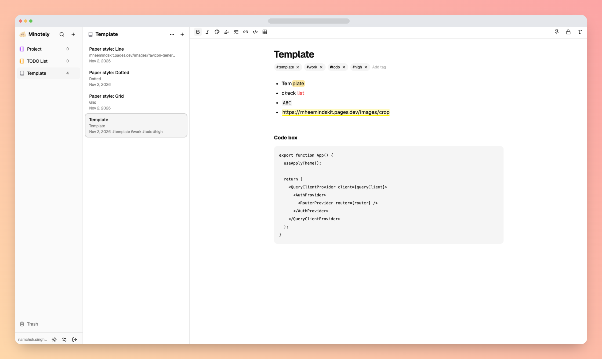

# minotely

A private, modern notebook web app for organizing books and notes, featuring rich-text Markdown editing, customizable paper styles, and seamless cross-device access.

Sign in with any Google account; each account sees only its own books and notes.



## Features

- **Library → Books → Notes** — books with color (preset or custom) and icon, drag to reorder, live note count.
- **Editor** — inline WYSIWYG (Tiptap) with live Markdown shortcuts and a Raw Markdown toggle; headings, lists,
  checklists, tables, code blocks, bold/italic, text color, highlight, and links with an edit bar. Editing Raw
  Markdown can remove text colors and custom highlights that Markdown cannot represent. Copying a rich-text
  selection places Markdown on the clipboard.
- **Reliable Auto Save** — every edit saved on the device at once (IndexedDB), synced 30 s after typing stops
  (at least every 5 min), keeps working offline, asks before overwriting a version changed elsewhere; Ctrl/⌘+S
  syncs now.
- **Organize** — pin, lock (read-only), tags with filter, sort (updated, created, A–Z, custom), move notes by drag
  and drop, Trash with restore.
- **Find** — search titles, content and `#tags` across all books (Ctrl/⌘+K).
- **Reading** — paper styles (plain, lined, grid, dotted), editor font and size, light/dark theme.
- **Data** — JSON backup export/import, Markdown export/import per note.
- **Responsive** — 3 resizable columns on desktop, collapsible Library on tablet, one screen at a time with a
  bottom menu on mobile.
- **Keyboard and accessibility** — shortcuts with hints, app right-click menus (a second right-click opens the
  browser menu), reduced-motion support.

## Tech stack

| Area          | Technology                                                  |
| ------------- | ----------------------------------------------------------- |
| App           | React 19, Vite 8, TypeScript 6, React Router                |
| UI            | Tailwind CSS v4, shadcn/ui + Radix UI, Lucide React, sonner |
| Editor        | Tiptap 3 (+ `@tiptap/markdown`, task lists)                 |
| Drag and drop | `@dnd-kit`                                                  |
| State         | TanStack Query (server data), Zustand (UI state)            |
| Backend       | Firebase Authentication (Google), Cloud Firestore           |
| Local storage | Dexie (IndexedDB drafts)                                    |
| Hosting       | Firebase Hosting, deployed by GitHub Actions                |
| Tooling       | pnpm, ESLint, Prettier, Vitest                              |

## Project structure

```
src/
  app/            app root, router, layout (columns, bottom menu, resize, drag and drop)
  components/     shared components; ui/ holds shadcn/ui
  features/
    auth/         Google sign-in, route guard
    books/        Library, book dialog, colors and icons
    notes/        note list, sort, tags
    editor/       Tiptap editor, toolbar, link bar, Auto Save
    search/       search dialog
    trash/        Trash
    settings/     synced editor settings, mobile Settings screen
    data/         JSON backup, Markdown import/export
  lib/            Firebase, Firestore, Dexie, shared hooks
  stores/         Zustand UI store
docs/             requirements, plan, progress, decisions, security
firestore.rules   per-user access and field validation
firebase.json     Hosting and rules config
```

Architecture rules and working conventions: `AGENTS.md`. Design decisions: `docs/DECISIONS.md`.

## Getting started

1. `pnpm install`
2. Copy `.env.example` to `.env.local` and fill in the Firebase web app config.
3. In Firebase Console → Authentication → Sign-in method, enable Google.
4. `pnpm dev`

| Command      | What it does                    |
| ------------ | ------------------------------- |
| `pnpm dev`   | run the app locally             |
| `pnpm build` | type-check and production build |
| `pnpm lint`  | run ESLint                      |
| `pnpm test`  | run Vitest                      |

## Deploy (Firebase Hosting)

Pushing to the `production` branch deploys the site (`.github/workflows/deploy-production.yml`): install, lint,
build, deploy to the live channel.

One-time setup:

1. `npm install -g firebase-tools`, `firebase login`, then `firebase use --add` (pick `minotely`).
2. Firebase Console → Hosting → Get started (once per project).
3. Deploy service account, in Google Cloud Console with **Project ID `minotely`** selected (another project may
   share the display name "minotely" — check the ID):
   - IAM & Admin → Service Accounts → use or create the deploy account; its email must end in
     `@minotely.iam.gserviceaccount.com`.
   - IAM & Admin → **IAM** (project level, not the service account's Permissions tab) → grant it Firebase Hosting
     Admin, Firebase Authentication Admin, API Keys Viewer, Cloud Run Viewer and Service Usage Consumer.
   - Service account → Keys → Add key → JSON. Paste the whole file into the GitHub secret
     `FIREBASE_SERVICE_ACCOUNT_MINOTELY`, then delete the file. Never commit it.
4. GitHub → Settings → Secrets and variables → Actions → **Variables**: add the six `VITE_FIREBASE_*` keys from
   `.env.example` with your values.

Release:

```bash
git switch production
git merge develop
git push origin production              # starts the deploy
```

Security Rules are not deployed by the workflow; publish them by hand when `firestore.rules` changes:

```bash
firebase deploy --only firestore:rules
```

The site is served at `https://minotely.web.app` and `https://minotely.firebaseapp.com`; both are already authorized
domains for Firebase Auth. Security notes: `docs/SECURITY.md`.

## Roadmap

- **Post-MVP:** version history.

Status details: `docs/PROGRESS.md`.

---

© _2026 Namchok Singhachai_. Minotely is released under the [MIT License](LICENSE).
