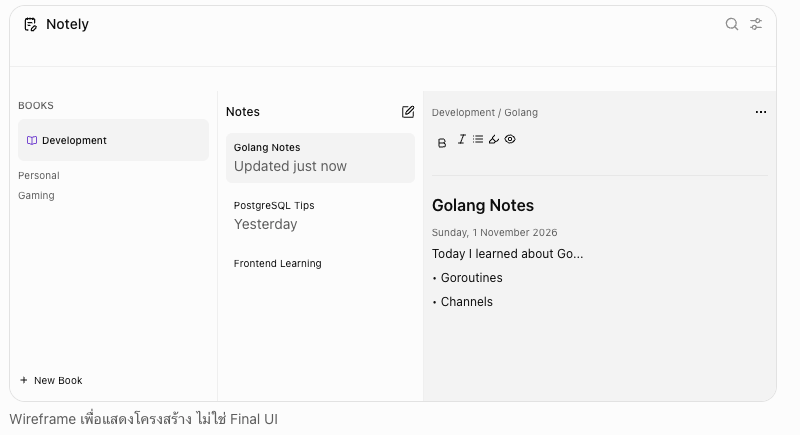
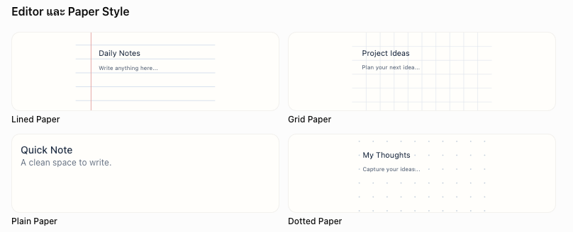

# minotely

- A private, modern notebook web app for organizing books and notes, customizable paper styles, and seamless cross-device access.
- Private by Data Access — เว็บเปิด URL ได้ แต่บุคคลอื่นไม่มีสิทธิ์อ่านหรือเขียน Note จาก Firestore
- Auto Save ที่เชื่อถือได้ — มีสถานะ Saved on this device / Syncing / Synced / Offline / Error, sync หลังหยุดพิมพ์ 30 วินาที (อย่างน้อยทุก 5 นาที) และ Draft ในเครื่อง เพื่อไม่ให้ข้อความหายระหว่างพิมพ์หรือสลับอุปกรณ์
- แบบที่ต้องการคือ WYSIWYG Editor (What You See Is What You Get) ที่รองรับ Markdown Shortcuts แบบ Real-time ไม่ใช่ Markdown Source Editor
- UX/UI Modern สวย ทันสมัยและใช้งานง่าย

## Notebook Structure

My Library

- Development
  - Golang Notes
  - PostgreSQL Tips
  - Frontend Learning
- Personal
  - Daily Notes
  - Ideas
- Gaming
  - Minecraft Modpack

ความสัมพันธ์คือ `Library → Books → Notes` โดย Book หนึ่งเล่มมี Notes ได้ไม่จำกัดจำนวน (Book เลือก ICON และ สี ได้เหมือน ChatGPT in Web)

## Core Features

| Feature           | Requirement                              | Priority |
| ----------------- | ---------------------------------------- | -------- |
| Authentication    | GoogleSign-in (ทุกบัญชี, ข้อมูลแยกต่อคน) | P0       |
| BookManagement    | Create,Rename,Delete,Color               | P0       |
| NoteManagement    | Create,Edit,Delete,Move                  | P0       |
| Markdown          | Heading,List,Table,CodeBlock             | P0       |
| RichText          | Bold,Italic,Highlight,TextColor          | P0       |
| EditorMode        | Edit WYSIWYG                             | P0       |
| AutoSave          | บันทึกอัตโนมัติ                          | P0       |
| Search            | ค้นหาTitleและContent                     | P0       |
| Responsive        | Desktop,Tablet,Mobile                    | P0       |
| PaperStyles       | Lined,Grid,Plain,Dotted                  | P1       |
| Pin/Favorite      | ปักหมุดNoteสำคัญ                         | P1       |
| Tags              | ติดTagให้Note                            | P1       |
| Sorting           | Updated,Created,A–Z,Custom               | P1       |
| Import/Export     | Markdown,JSON                            | P1       |
| Trash             | กู้คืนNoteที่ลบ                          | P1       |
| OfflineMode       | อ่าน/แก้ไขเมื่อไม่มีอินเทอร์เน็ต         | P2       |
| VersionHistory    | ดูประวัติการแก้ไขNote                    | P2       |
| KeyboardShortcuts | ควบคุมEditorด้วยคีย์บอร์ด                | P2       |

## UX/UI Design



Wireframe เพื่อแสดงโครงสร้าง ไม่ใช่ Final UI

Layout ตามขนาดหน้าจอ

- Desktop: 3 Columns — Books / Notes / Editor
- Tablet: Collapsible Books Sidebar + Notes + Editor
- Mobile: ใช้การนำทางทีละหน้าจอ Books → Notes → Editor โดยมีปุ่ม Back ชัดเจน

### Editor และ Paper Style

- Editor Type: Inline WYSIWYG
- Editing: Always Editable
- Markdown: Live Formatting Shortcuts
- Storage: Tiptap JSON
- No Edit / Preview Toggle
- ไม่มี Raw Markdown Source Editing



ให้ใช้ Paper Style เป็นพื้นหลังของ Editor เท่านั้น ไม่ต้องบังคับข้อความทุกบรรทัดให้ตรงกับเส้นกระดาษ เพราะ Rich Text ที่มี Heading, Code Block และ Table จะมีความสูงไม่เท่ากัน

สำหรับ Motion ควรใช้เพียงการเปิดปิด Sidebar, สลับ Notes, เปลี่ยน Hover ของปุ่มเล็กน้อย ระยะเวลาประมาณ 150–250ms พร้อมรองรับ `prefers-reduced-motion`

## Recommended Tech Stack

| Category       | Technology             | เหตุผล                          |
| -------------- | ---------------------- | ------------------------------- |
| Frontend       | React+Vite+TypeScript  | เหมาะกับSPAและStaticHosting     |
| Styling        | TailwindCSSv4          | จัดการResponsiveและTheme        |
| UIComponents   | shadcn/ui+RadixUI      | ใช้งานสะดวกและปรับแต่งได้       |
| Editor         | Tiptap                 | RichTextEditorที่ปรับแต่งได้มาก |
| Animation      | Motion                 | TransitionและMicro-interaction  |
| Icons          | LucideReact            | Iconเรียบง่าย                   |
| Router         | ReactRouter            | จัดการหน้าและURL                |
| ServerState    | TanStackQuery          | จัดการFetchingและCache          |
| LocalState     | Zustand                | จัดการUIState                   |
| Authentication | FirebaseAuthentication | GoogleSign-in                   |
| Database       | CloudFirestore         | SyncNotesข้ามอุปกรณ์            |
| LocalCache     | IndexedDB/Dexie        | CacheและDraftในBrowser          |
| Deployment     | FirebaseHosting        | Deployเองด้วยFirebaseCLI        |

Package Manager: `pnpm`

## ใช้ Firebase, Firestore Data Structure

สำหรับ MVP ผมแนะนำโครงสร้างแบบนี้:

```
users/
  {uid}/
    preferences/
      settings
        fontFamily (sans | serif | mono)
        fontSize (sm | md | lg)
    books/
      {bookId}/
        name
        color (preset key or #rrggbb)
        icon
        order
        createdAt
        updatedAt
    notes/
      {noteId}/
        bookId
        title
        content (Tiptap JSON string — D10)
        plainText
        tags
        isPinned
        isLocked
        paperStyle
        order
        createdAt
        updatedAt
        deletedAt
```

## Access & Routing

- Sign-in ได้ทุก Google Account แต่ละบัญชีอ่าน/เขียนได้เฉพาะข้อมูลของตัวเอง (`users/{uid}`) บังคับใน Firestore Security Rules
- Routing ใช้ `BrowserRouter` และ Firebase Hosting rewrite ทุก path ไปที่ `index.html` (URL ไม่มี `#`)

## Development Roadmap

รวม 6 Phase เดิมเป็น 4 Milestone รายละเอียดใน `docs/PLAN.md`

M1 — Foundation & Deploy (Phase 1 + Deploy จาก Phase 6)

Project setup, Theme (Light/Dark tokens), Responsive Layout, Sidebar, Routing, Firebase Authentication, Firebase Hosting (deploy เองด้วย `firebase deploy --only hosting`)

M2 — Core Notebook (Phase 2 + 3 + Sync จาก Phase 5)

Books & Notes CRUD, Firestore Sync, Security Rules (ทดสอบกับ Firebase Project จริง ไม่ใช้ Emulator/Mock), Sorting, Pinned Notes, Delete Confirmation, Tiptap (Markdown, Text Color, Highlight, Tables, Code Blocks), Auto Save, Sync Status, IndexedDB Drafts

M3 — Reading & Data (Phase 4 + ส่วนที่เหลือของ Phase 5)

Paper Styles, Typography, Search, Tags, Motion, Mobile Polish, Trash, Import/Export, Custom Sort

M4 — Hardening & Release (ส่วนที่เหลือของ Phase 6)

Performance, Accessibility, Security Rules Review, Release

Post-MVP (P2): Offline Mode, Version History, Keyboard Shortcuts
